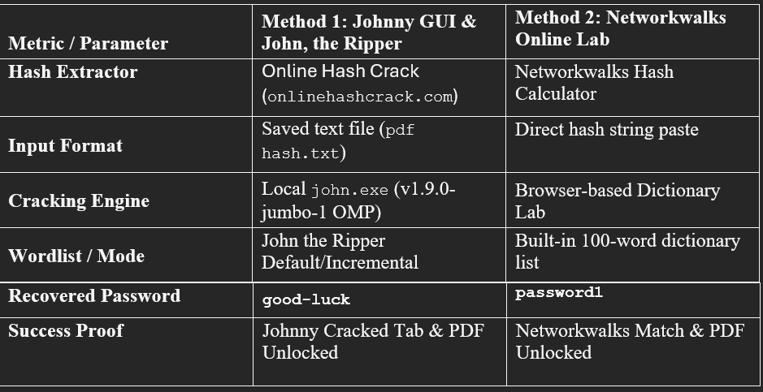

## Overview of the Password Cracking Workflow
This documentation covers the step-by-step procedures demonstrated in the provided screenshots for extracting hashes from password-protected PDF files (My Locked PDF1.pdf) and recovering their passwords using two distinct methods: Johnny GUI (John the Ripper Frontend) and Networkwalks Online Lab Tools.
## Method 1:
Local Cracking with Johnny GUI (John the Ripper)
## Step 1: Environment Setup & Executable Path Configuration
1.	Initial State: Upon launching Johnny GUI, the Settings tab initially displayed an error indicating "No valid John The Ripper executable detected at this path !" when configured to the john-1.9.0-jumbo-1-win64 root folder.
.png>)
2.	Path Resolution: The path was updated to point directly to the binary executable located at john-1.9.0-jumbo-1-win64\run\john.exe.

3.	Detection Confirmation: Johnny successfully validated the engine as John the Ripper 1.9.0-jumbo-1 OMP [cygwin 64-bit x86_64 AVX2 AC].
.png>)
## Step 2: Extracting PDF Hash Online
1.	Extractor Tool Access: Navigated to the Online HashCrack PDF Hash Extractor page (onlinehashcrack.com/tools-pdf-hash-extractor.php).
.png>)

.png>)
2.	File Processing: Uploaded My Locked PDF1.pdf to extract the crackable hash string.

3. Extracted Hash: Generated the $pdf$ hash format compatible with pdf2john / hashcat:
 .png>)
**$pdf$4*4*128*-
1028*1*16*ca7f72f11459cba469f1005a8765ed51*32*f32d8fa1bfbe2648226dffc39f7909ea0021446990b9e4114071a4d9104984c1*32*9322f50c29569712067a775264635e4954ccb1b99e209d664984054ffad30a6a

## Step 3: Hash Ingestion into Johnny GUI

1.	File Storage: The extracted hash string was saved to a text file named pdf hash.txt using Notepad.
.png>)
2.	Import: In Johnny GUI, selected File > Open password file > Open password file (PASSWD format) and selected pdf hash.txt from the directory.
.png>)
.png>)
3.	Session View: The hash was loaded into the Passwords tab, properly identified with format PDF and showing status 0% (0/1: 0 cracked, 1 left).
.png>)

## Step 4: Attack Execution & Success Verification (Confirmation 1)

1.	Execution: Clicked Start new attack to run John the Ripper against the loaded hash.
.png>)
2.	Cracking Result: Johnny completed the session, marking progress as 100% (1/1: 1 cracked, 0 left). The cracked password was revealed as good-luck.
.png>)
3.	Access Verification: Opened My Locked PDF1.pdf in the viewer, entered good-luck, and confirmed successful file decryption.
.png>)
-1.png>)
________________________________________
## Method 2: Web-Based Cracking via Networkwalks Tools

## Step 1: Online Hash Extraction
1.	Tool Access: Navigated to the Networkwalks Hash Calculator (networkwalks.com/hash-calculator/).

.png>)
.png>)
2.	Hash Generation: Dropped My-Locked-PDF1.pdf, extracting the following $pdf$ hash: 
.png>)
3.	$pdf$4*4*128*-
1060*1*16*55d1a5c14175da449753199e44971d32*32*777fd021a7f3c5ae598c0c6495c7f76e00000000000000000000000000000000*32*ceecdac74b19b5a62688d3b3524e1374c955cbb9cc3c45316494d9446ef81af1
4.	Clipboard Export: Clicked Copy to copy the extracted hash string.
.png>)
## Step 2: Dictionary Attack Execution
1.	Cracker Configuration: Navigated to the Networkwalks Password Cracker (networkwalks.com/password-cracker/) and pasted the $pdf$ hash into the input area.
2.	Wordlist Selection: Activated the Built-in list (100 passwords) dictionary.
.png>)
3.	Running the Attack: Initiated cracking; live attempts were logged against common wordlist entries (e.g., master, 666666, superman, 1qaz2wsx, password).
.png>)
## Step 3: Success Verification (Confirmation 2)
1.	Cracking Result: Upon reaching 91% progress, the tool logged [+] MATCH password1 and displayed PASSWORD CRACKED SUCCESSFULLY: password1.
.png>)
2.	Access Verification: Opened My Locked PDF1.pdf in Edge PDF Reader, entered password1, and unlocked the document.
.png>)
________________________________________
## Technical Summary Matrix

.png>)

